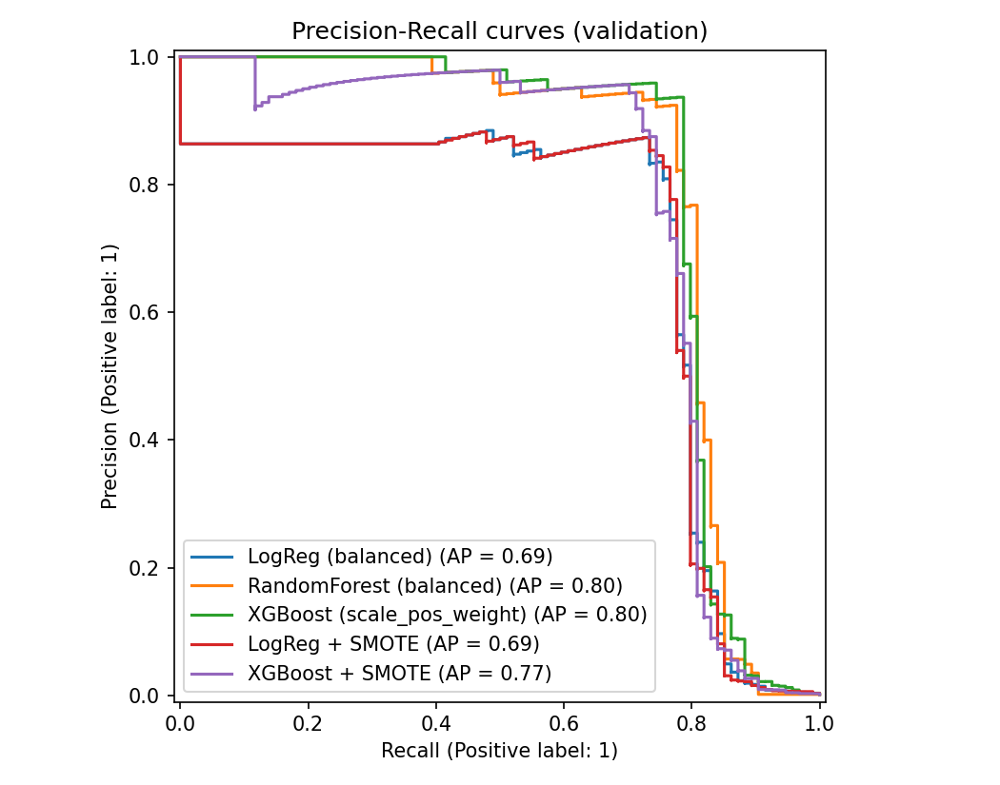
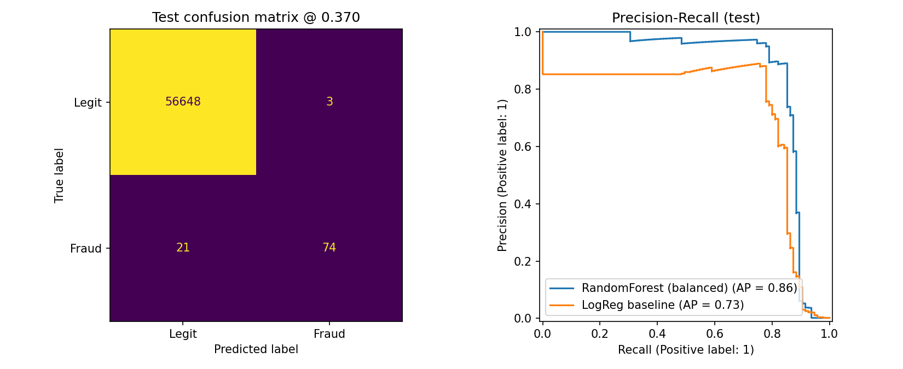
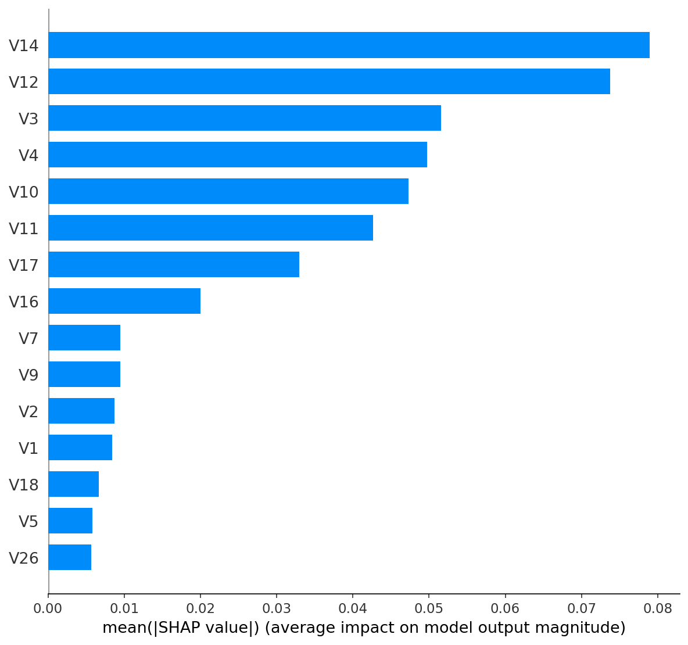

# Credit Card Fraud Detection

An end-to-end machine learning project that detects fraudulent credit card transactions: data cleaning, imbalance handling, model comparison, threshold tuning, SHAP explanations, an honest held-out test evaluation, and a Flask web app packaged with Docker.

**Result in one line:** on a held-out test set (95 frauds out of 56,746 transactions), the tuned Random Forest reaches **96% precision and 78% recall** (PR-AUC 0.86), cutting false alarms from **1,297** (logistic regression baseline) to **3**.

## Problem

Fraud is rare. In this dataset only about 0.17% of transactions are fraudulent, so a model that never flags anything would still be about 99.8% "accurate". Accuracy is useless here, and every false alarm annoys a real customer, so the project is judged on **precision, recall, F1 and PR-AUC**.

## Dataset

[Credit Card Fraud Detection](https://www.kaggle.com/datasets/mlg-ulb/creditcardfraud) from the ULB Machine Learning Group on Kaggle: 284,807 European card transactions over two days. Features `V1` to `V28` are anonymised PCA components; `Time` and `Amount` are the only original columns. The dataset is not included in this repository. Download `creditcard.csv` from Kaggle and check the dataset page for its license terms.

## Approach

1. **Cleaning:** removed 1,081 exact duplicate rows (19 of them frauds) *before* splitting, so identical transactions cannot appear in both train and test. After cleaning: 283,726 rows, 473 frauds (0.167%).
2. **Split:** stratified 60% train / 20% validation / 20% test, so each part keeps the tiny fraud rate. The test set was used once, at the end.
3. **No leakage:** scaling of `Time` and `Amount` is fitted on training data only, inside a pipeline.
4. **Baselines:** a no-skill dummy model and a class-weighted logistic regression.
5. **Models compared on validation data:** Random Forest and XGBoost with class weights, and logistic regression and XGBoost with SMOTE oversampling. The full table is in [`results/step2_model_comparison_validation.csv`](results/step2_model_comparison_validation.csv).
6. **Selection:** the model with the best validation PR-AUC (Random Forest, validation PR-AUC about 0.80) was chosen.
7. **Threshold tuning:** the decision threshold was chosen on validation data (0.37 for best F1) instead of using the default 0.5.
8. **Explainability and error analysis:** SHAP values and a review of missed frauds and false alarms.
9. **Deployment:** Flask app with a JSON API and demo page, containerised with Docker.



## Final results (held-out test set, 95 frauds)

| Model | Precision | Recall | F1 | False alarms | Missed frauds |
|---|---|---|---|---|---|
| Logistic regression baseline (threshold 0.50) | 0.062 | 0.905 | 0.116 | 1,297 | 9 |
| Random Forest (threshold 0.50) | 0.973 | 0.747 | 0.845 | 2 | 24 |
| **Random Forest (threshold 0.37, chosen on validation)** | **0.961** | **0.779** | **0.861** | **3** | **21** |
| Random Forest (threshold 0.11, higher recall option) | 0.835 | 0.853 | 0.844 | 16 | 14 |

**PR-AUC on the test set: 0.858 for Random Forest vs 0.731 for the baseline.**

ROC-AUC was almost identical for the two models (0.966 vs 0.967), which is exactly why it is misleading on imbalanced data and why PR-AUC is used here.

The choice of threshold is a business decision. A threshold of 0.37 favours precision (very few false alarms); 0.11 catches 7 more frauds in this test set at the cost of 13 more false alarms.



## What drives the predictions (SHAP)

The most influential features are `V14`, `V12`, `V3`, `V4`, `V10`, `V11`, `V17` and `V16`; `Time` and `Amount` are not among the top eight. Because `V1` to `V28` are anonymised PCA components, this shows *which* components matter, not what they mean in business terms.



## Error analysis (validation set)

- 73 frauds caught, 21 missed, 6 false alarms.
- 9 of the 21 missed frauds received a fraud score of exactly 0.000 and none scored above 0.13, so the model sees them as completely normal. Lowering the threshold would not recover most of them.
- Missed frauds were not only small amounts: several were large (for example 2,126, 634 and 549), so a cost-weighted threshold would be a sensible next step.
- All 6 false alarms were very small transactions (amounts between 1.00 and 2.69).

## Limitations

- Only about 95 frauds per evaluation split, so metrics are noisy: one fraud moves recall by about 1 point. Differences of a few points between models should not be over-interpreted.
- Random (not time-based) split, on a dataset covering only two days.
- Anonymised PCA features limit interpretability.
- The costs of a missed fraud versus a false alarm are assumed, not measured.
- This is a portfolio demo, not a production fraud system.

## Run the web app locally

Python 3.13 and the pinned versions in `requirements.txt` are used (a pickled scikit-learn model needs a matching version).

```bash
git clone https://github.com/bhardwajarpit888-hash/credit-card-fraud-detection.git
cd credit-card-fraud-detection
pip install -r requirements.txt
python app.py
```

Open http://127.0.0.1:5000, click **Load sample: fraud** or **Load sample: legitimate**, then **Check transaction**.

### With Docker

```bash
docker build -t fraud-detector .
docker run --rm -p 7860:7860 fraud-detector
```

Open http://localhost:7860.

### API

- `GET /health` returns the model name and number of features.
- `POST /predict` takes a JSON object with `Time`, `V1` to `V28` and `Amount`, and returns `fraud_probability`, `is_fraud` and the `threshold` used.

## Reproduce the training

Download `creditcard.csv` from Kaggle into the project folder, then run `fraud_detection.ipynb` from top to bottom. It recreates every table and plot in `results/` and the model in `artifacts/`.

## Project structure

```
app.py                      Flask app (demo page + JSON API)
Dockerfile                  container for the app
requirements.txt            pinned dependencies
fraud_detection.ipynb       data cleaning, modelling, evaluation, SHAP
artifacts/                  saved model, threshold config, sample transactions
results/                    plots and metric tables
templates/index.html        demo page
```

## Author

Arpit Bhardwaj, B.Tech CSE (AI-ML), Maharaja Agrasen Institute of Technology. [LinkedIn](https://linkedin.com/in/arpit-bhardwaj-0b8398391)